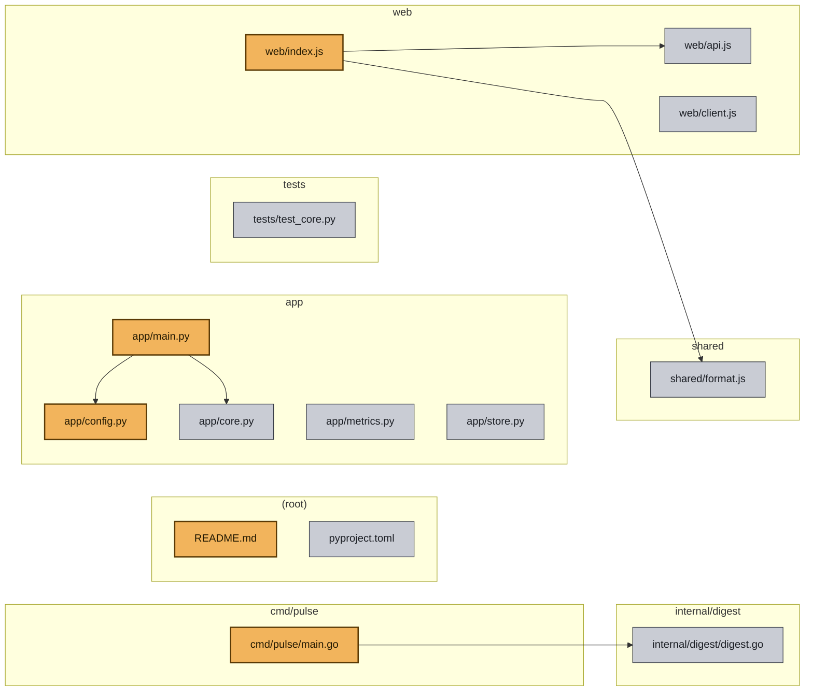

# Repo Cartography: sample-repo

The agent explored sample-repo and catalogued 14 files. By file count the mix is python 6, javascript 4, go 2. It read 4 files and resolved 5 import edges between files. It recorded 4 notes along the way. The loop used 4 of its 4 allowed steps and stopped because step budget exhausted. The run took 1m22s. Every decision was made by the local open model `qwen2.5:1.5b` running under Ollama, with no cloud API calls.

## Architecture

## Read these first

**1.** `cmd/pulse/main.go` — the CLI entrypoint under cmd/ — it parses the flags and starts the run, so it names every moving part; the agent opened this file while exploring, so it is on the trail it followed — agent note: package main - fixture: part of repo-cartographer's testdata/sample-repo, not a real project (2 imports)

**2.** `app/main.py` — program entrypoint — the main function that wires the pieces together and starts them; the agent opened this file while exploring, so it is on the trail it followed — agent note: def main(): - fixture: part of repo-cartographer's testdata/sample-repo, not a real project (2 imports)

**3.** `web/index.js` — package entrypoint — the module every consumer loads first, so it maps the public surface; the agent opened this file while exploring, so it is on the trail it followed — agent note: fixture: part of repo-cartographer's testdata/sample-repo, not a real project (2 imports)

**4.** `README.md` — the project README — the author's own description of what this is and how to run it; the agent opened this file while exploring, so it is on the trail it followed — agent note: Pulse

**5.** `app/config.py` — imported by one other file in the repo — a shared piece rather than a leaf

## Files the agent read

- `app/main.py`
- `cmd/pulse/main.go`
- `web/index.js`
- `README.md`

---

Generated by Repo Cartographer. This report is the output of an autonomous observe-decide-act loop driven by the local open model `qwen2.5:1.5b` via Ollama; no cloud API calls were made.
