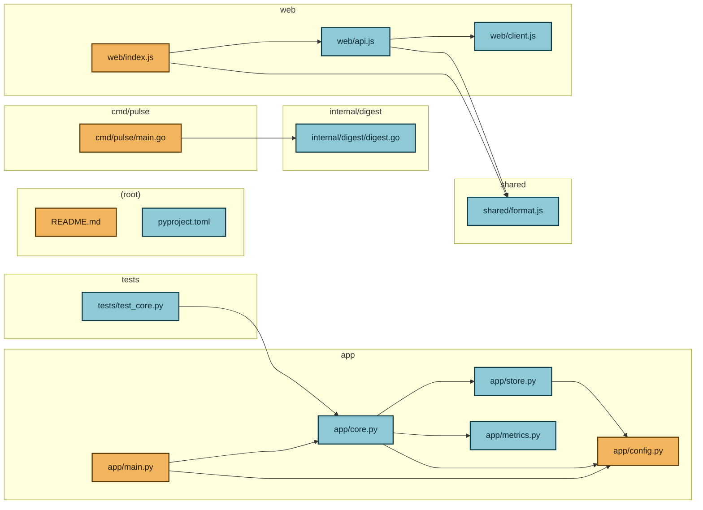
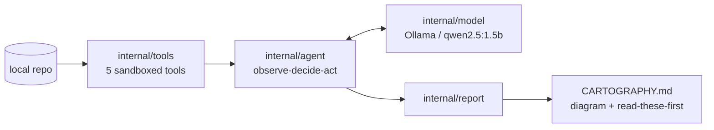

# Repo Cartographer

**Point it at a repository and a local open-weights model explores it on its own, then draws you the map.**

Repo Cartographer is an agentic repo explorer. It does not pattern-match a
directory listing: a small language model running on your own machine is given
five MCP-style tools and a step budget, and it decides — one step at a time —
which file to read, what to search for and which imports to follow. When it is
satisfied (or out of budget) it writes a single markdown report containing a
Mermaid architecture diagram and a ranked "read these files first" onboarding
guide.

Everything runs locally. The brain is **Qwen2.5 1.5B Instruct** served by
[Ollama](https://ollama.com); there are no API keys, no accounts, no hosted
services and no GPU requirement.

```
cartographer --repo ../some-project --out CARTOGRAPHY.md
```

---

## What it does

It produces one markdown file. Below is **real output** from a run against this
repo's own `testdata/sample-repo` fixture — the diagram and the ranking are
verbatim; the "read these first" reasons have had their trailing `agent note:`
clauses elided and the file list truncated, both marked:

````markdown
# Repo Cartography: sample-repo

The agent explored sample-repo and catalogued 14 files. By file count the mix is
python 6, javascript 4, go 2. It read 14 files and resolved 12 import edges
between files. It recorded 14 notes along the way. The loop used 14 of its 14
allowed steps and stopped because step budget exhausted. The run took 9m5s.
Every decision was made by the local open model `qwen2.5:1.5b` running under
Ollama, with no cloud API calls.

## Architecture



## Read these first

**1.** `cmd/pulse/main.go` - the CLI entrypoint under cmd/ - it parses the flags
and starts the run, so it names every moving part; the agent opened this file
while exploring

**2.** `app/main.py` - program entrypoint - the main function that wires the
pieces together and starts them; the agent opened this file while exploring

**3.** `web/index.js` - package entrypoint - the module every consumer loads
first, so it maps the public surface

**4.** `README.md` - the project README - the author's own description of what
this is and how to run it

**5.** `app/config.py` - imported by 3 other files - a load-bearing abstraction
much of the code depends on

## Files the agent read

- `app/main.py`
- `cmd/pulse/main.go`
- `web/index.js`
- ... (14 in total)
````

Every import edge above was discovered by the agent at runtime, by reading files
the model chose and resolving their imports — the fixture's dependency graph is
reproduced exactly.

Nodes are coloured by role: the ranked starters, the files the agent actually
read, and everything else it only saw in the tree.

## Why it's agentic

There is no hardcoded exploration script. Each step is a full
**observe → decide → act → record** cycle, and the *decide* step is the model's:

1. **Observe.** The loop builds a `contracts.Observation`: the repo tree, the
   files already read, the files still unread, the available tools and a
   transcript of recent steps.
2. **Decide.** That observation is rendered into a prompt and sent to the local
   model, which answers with a JSON decision — a tool name plus arguments, or
   `done: true`. Nothing else chooses the next move.
3. **Act.** The loop looks the tool up in the registry and calls it, sandboxed
   to the repo root.
4. **Record.** The result is truncated into the transcript, visited files and
   resolved import edges are accumulated, and the next observation is built.

Two real steps, verbatim from a trace — note how one `read_file` decision by
the model makes the loop resolve that file's imports on its own:

```
step 5/25  read_file{path:app/core.py}  -> 592 B, 3 imports   (reason: main.py imports it)
step 5/25  follow_imports{path:app/core.py}  -> 3 imports, 3 resolved   (reason: agent auto-follow: resolve the imports of app/core.py)
```

Because a 1.5B model on a laptop is fallible, the loop is built to survive bad
decisions rather than to assume good ones:

- **Step budget** (`--budget`, default 25) caps the work and the wall clock.
- **Auto-follow of imports** means a single good `read_file` decision keeps
  paying off: resolved edges become diagram edges and unread-file candidates.
- **Visited tracking** stops the model re-reading the same file forever.
- **Repeat refusal.** Any call the agent has already made is refused and
  replaced with "read the next unread file". This one matters more than it
  sounds: left alone, `qwen2.5:1.5b` answers `repo_tree` ("understand the
  directory structure") on *every* step and finishes a run having read nothing.
- **Refusals are fed back to the model.** When the agent overrides a decision,
  the rejected call is recorded with the reason, so the model sees on its next
  turn that it was overridden and picks something else. Without that feedback it
  simply re-asks for the same thing, having never learned it was ignored.
- **The agent hides its own steps from the model.** The bootstrap tree and the
  automatic import-follows stay out of the transcript the model is shown,
  because a small model copies the shape of the last line it sees — show it its
  own auto-follow and the next decision is that same call again. They remain in
  the audit log (`Result.Steps`).
- **A no-progress guard** ends the run when the loop stops learning anything new.
- **A safe fallback decision** keeps the loop moving when the model emits
  unparseable output, an unknown tool or nonsense arguments — the run degrades
  into a slightly less clever exploration instead of crashing.
- **Sandboxed tools** mean a hallucinated `../../etc/passwd` is refused, not read.

The test suite holds that line: the end-to-end smoke test feeds the real loop a
deliberately invalid tool call (an unknown tool name with nonsense arguments)
and still expects a complete report out the other end.

### What a real run actually looks like

Measured on this repo's own `testdata/sample-repo` fixture (14 files, 3
languages) with `qwen2.5:1.5b` on a CPU-only laptop, `--budget 14`:

| | |
|---|---|
| Files read | 14 of 14 |
| Import edges resolved | 12 |
| Model calls | 14 (0 retries, 0 unparseable replies) |
| Wall clock | ~9 min (~35-40 s per step, CPU-only) |

Be honest about the brain: a 1.5B model is a weak planner. In that run it chose
a sensible next file on its own about half the time ("entrypoint wires the app
together", "understand how the project handles file imports") and spent the
other half asking for something it had already done — which the agent refused
and converted into progress. The map comes out right either way, and that is
the design: **the loop is engineered so that a flaky brain still produces a
useful result.** A larger `--model` makes the decisions better and the run
slower.

## The model

The agent's brain is **Qwen2.5 1.5B Instruct**, an open-weights model, run
locally by Ollama as `qwen2.5:1.5b`.

| | |
|---|---|
| Model page | https://huggingface.co/Qwen/Qwen2.5-1.5B-Instruct |
| License | [Apache-2.0](https://huggingface.co/Qwen/Qwen2.5-1.5B-Instruct/blob/main/LICENSE) |
| Ollama library entry | https://ollama.com/library/qwen2.5 |

1.5B is chosen deliberately: it is ~1 GB to download and it thinks fast enough
on a CPU to make a 25-step loop bearable. Any model Ollama can serve works —
pass `--model llama3.2:3b`, `--model qwen2.5:7b` or whatever you have pulled.
Bigger models make better decisions and take longer per step.

## Architecture

| Package | Role |
|---|---|
| `internal/contracts` | Frozen shared types (`Tool`, `Registry`, `Decision`, `Observation`, `Report`). Imports nothing, so no cycles. |
| `internal/tools` | The five MCP-style tools and the registry, all sandboxed to the repo root; plus source-file discovery and language detection. |
| `internal/model` | `contracts.Decider` on top of local Ollama: prompt building, very tolerant JSON parsing, one retry, then a safe fallback. The only package that does network I/O. |
| `internal/agent` | The observe → decide → act → record loop: budget, visited set, import graph accumulation, trace output. |
| `internal/report` | Turns the agent's findings into a `contracts.Report`: Mermaid diagram, ranked starters, summary; renders and writes the markdown. |
| `cmd/cartographer` | The CLI: flags and env, Ollama pre-flight check, signal handling, wiring. |



## Tools (MCP-style)

Each tool has a name, a model-facing description and an untyped argument map,
exactly like an MCP tool; the model picks one per step.

| Tool | Args | Returns |
|---|---|---|
| `read_file` | `{path}` | The file's contents (truncated for large files), its detected language and size. Marks the file visited. |
| `list_dir` | `{path}` | The entries of one directory, marking which are directories. |
| `search` | `{pattern, path?}` | Matching lines with their file and line number, optionally scoped to a subtree. |
| `follow_imports` | `{path}` | The file's import statements, with the intra-repo ones resolved to real repo paths — these become the diagram's edges. |
| `repo_tree` | `{}` | A compact tree of the repository, pruned of vendor/build/VCS noise. |

Every path argument is resolved through one sandbox: `..` escapes, absolute
paths outside the root and symlinks pointing out of the root are refused, and
nothing outside `--repo` is ever read. Tools also coerce defensively — small
models send `null` args, numbers where strings belong and quoted paths — and
return a descriptive error instead of panicking.

## Install

1. **Install Ollama** — https://ollama.com/download
2. **Pull the model** (one-time, ~1 GB — the only network step this project
   ever needs):
   ```
   ollama pull qwen2.5:1.5b
   ```
3. **Build the CLI** (Go 1.25+, no third-party dependencies to fetch):
   ```
   go build ./cmd/cartographer
   ```

Make sure the server is up (`ollama serve`, or the desktop app) and you are
done. After the pull you can turn your networking off entirely.

## Usage

```
./cartographer --repo ../some-project --out CARTOGRAPHY.md
```

Write to stdout instead of a file, and watch the agent think on stderr:

```
./cartographer --repo ../some-project --out - --verbose > map.md
```

### Flags

| Flag | Default | Env fallback | Meaning |
|---|---|---|---|
| `--repo` | `.` | `CARTOGRAPHER_REPO` | Repository to map. Resolved to an absolute path; must be an existing directory. |
| `--model` | `qwen2.5:1.5b` | `CARTOGRAPHER_MODEL` | Local Ollama model to think with. |
| `--ollama-url` | `http://localhost:11434` | `CARTOGRAPHER_OLLAMA_URL`, `OLLAMA_HOST` | Ollama base URL. A bare `host:port` is accepted and normalised. |
| `--budget` | `25` | `CARTOGRAPHER_BUDGET` | Maximum exploration steps. |
| `--out` | `CARTOGRAPHY.md` | `CARTOGRAPHER_OUT` | Report path. `-` writes the markdown to stdout. |
| `--timeout` | `10m` | `CARTOGRAPHER_TIMEOUT` | Overall run timeout (`0` for none). |
| `--model-timeout` | `2m0s` | `CARTOGRAPHER_MODEL_TIMEOUT` | Per-request model timeout; CPU inference is slow. |
| `--starters` | `5` | `CARTOGRAPHER_STARTERS` | How many files to rank in "read these first". |
| `--max-nodes` | `40` | `CARTOGRAPHER_MAX_NODES` | Maximum nodes in the Mermaid diagram. |
| `--verbose`, `-v` | `false` | `CARTOGRAPHER_VERBOSE` | Stream the per-step trace to stderr. |
| `--skip-health` | `false` | `CARTOGRAPHER_SKIP_HEALTH` | Skip the pre-flight Ollama check and try anyway. |
| `--version` | | | Print the version and exit. |

Flags beat environment variables, which beat the defaults.

Human output — progress, the trace, warnings, the Ollama hint and the closing
summary — always goes to **stderr**; stdout carries the report and only when
`--out -`. Exit codes: `0` report written, `1` runtime failure, `2` bad usage
(including an unusable `--repo`).

### A `--verbose` trace excerpt

Real output, abridged in the middle. Note step 1: the model asks for the tree it
has already been given, the agent refuses and converts the step into a file
read; by step 2 it is choosing sensibly on its own.

```
mapping /home/me/src/repo-cartographer/testdata/sample-repo with qwen2.5:1.5b (budget 14 steps)
step 0/14  repo_tree{}  -> 14 files   (reason: bootstrap: map the repository before the first model decision)
step 1/14  repeat of repo_tree{} - substituting
step 1/14  read_file{path:app/main.py}  -> 412 B, 2 imports   (reason: agent fallback (already called repo_tree{} earlier in this run): reading next unread file app/main.py)
step 1/14  follow_imports{path:app/main.py}  -> 2 imports, 2 resolved   (reason: agent auto-follow: resolve the imports of app/main.py)
step 2/14  read_file{path:cmd/pulse/main.go}  -> 204 B, 2 imports   (reason: entrypoint wires the app together)
step 2/14  follow_imports{path:cmd/pulse/main.go}  -> 2 imports, 1 resolved   (reason: agent auto-follow: resolve the imports of cmd/pulse/main.go)
step 3/14  read_file{path:web/index.js}  -> 354 B, 2 imports   (reason: find the entrypoints)
step 3/14  follow_imports{path:web/index.js}  -> 2 imports, 2 resolved   (reason: agent auto-follow: resolve the imports of web/index.js)
step 4/14  web/index.js already read - substituting
step 4/14  read_file{path:README.md}  -> 427 B, 0 imports   (reason: agent fallback (already read web/index.js): reading next unread file README.md)
...
step 7/14  read_file{path:internal/digest/digest.go}  -> 247 B, 1 imports   (reason: understand how the project handles file imports)
step 7/14  follow_imports{path:internal/digest/digest.go}  -> 1 imports, 0 resolved   (reason: agent auto-follow: resolve the imports of internal/digest/digest.go)
...
stopped: step budget exhausted (steps used 14/14, 14 files read, 12 import edges)

steps used:      14/14
files read:      14 of 14 source files
import edges:    12
model calls:     14 (retries 0, fallbacks 0, parse failures 0)
stopped because: step budget exhausted
elapsed:         9m4.772s
report:          CARTOGRAPHY.md
```

Budget the wall clock: on a CPU-only laptop each step costs roughly 15-40
seconds of local inference, so the default `--budget 25` is a ~10-20 minute run.
Use a smaller `--budget` for a quick look.

If the server is not running or the model is not pulled, the pre-flight check
says so once, with the exact commands to fix it, and exits non-zero.

## Offline, no GPU, no cloud, no API keys

This is a hard constraint of the project, not a nice-to-have:

- **All inference is local.** `internal/model` speaks HTTP to Ollama at
  `http://localhost:11434` (configurable with `--ollama-url`) and that is the
  only network I/O in the entire program.
- **Nothing is sent to Anthropic, OpenAI or any hosted API.** Your source code
  never leaves your machine.
- **No keys, no accounts, no sign-up.** There is no credential to configure,
  because there is no service to authenticate against.
- **No GPU needed.** CPU-only works; it is simply slower per step, which is why
  the default model is 1.5B and `--model-timeout` defaults to two minutes.
- **Works with networking off** once `ollama pull` has been run.
- **CI enforces it.** `TestNoPaidAPIEndpoints` walks every Go source file in
  the module (test fixtures aside) and fails the build if any of them mentions a
  hosted AI endpoint or an `ANTHROPIC_`/`OPENAI_`-style credential, and a
  companion test asserts that no package outside `internal/model` imports
  `net/http` at all.

## Tech stack

- **Go 1.25**, standard library only — zero third-party dependencies, by design.
- **Ollama** for local model serving.
- **Qwen2.5 1.5B Instruct** (Apache-2.0) as the default brain.
- **Mermaid** for the architecture diagram, so the report renders on GitHub.
- **GitHub Actions** for CI: `gofmt`, `go vet`, `go build`, `go test -race`.

## Development

```
go build ./...
go test ./...
go test -race ./...
```

`testdata/sample-repo` is a small multi-language fixture repo (a Python ingest
pipeline, a JavaScript dashboard, a Go CLI) with a deliberately clear import
graph. The end-to-end smoke test drives the **real** agent loop and the **real**
tools over that fixture with a stub `contracts.Decider` in place of the model —
so the whole test suite is fast, deterministic and **needs no Ollama and no
network**, in CI or on your laptop.

## License

[MIT](LICENSE).

*Claude Code assisted with authoring this repository; the runtime AI is the
local open-weights model (Qwen2.5-1.5B via Ollama) — no Anthropic or other
hosted API is called at runtime.*
